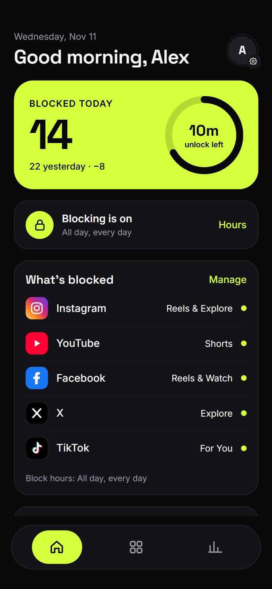
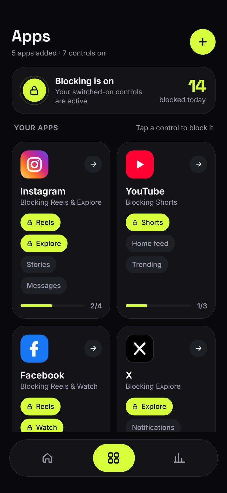
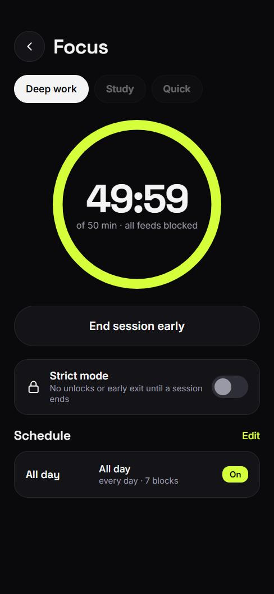
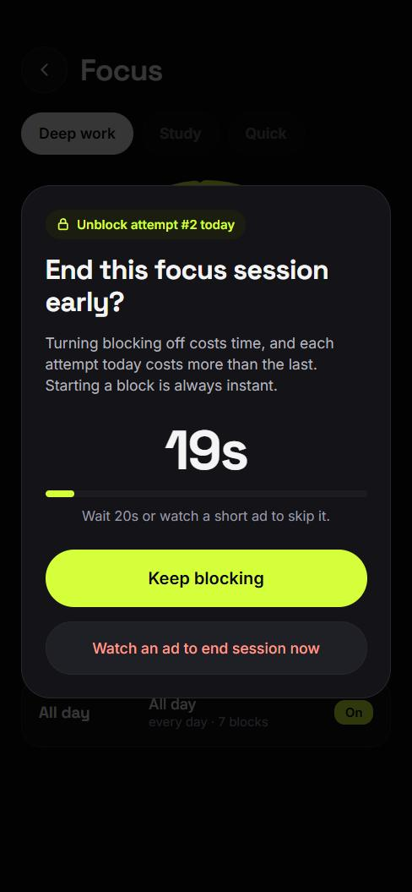
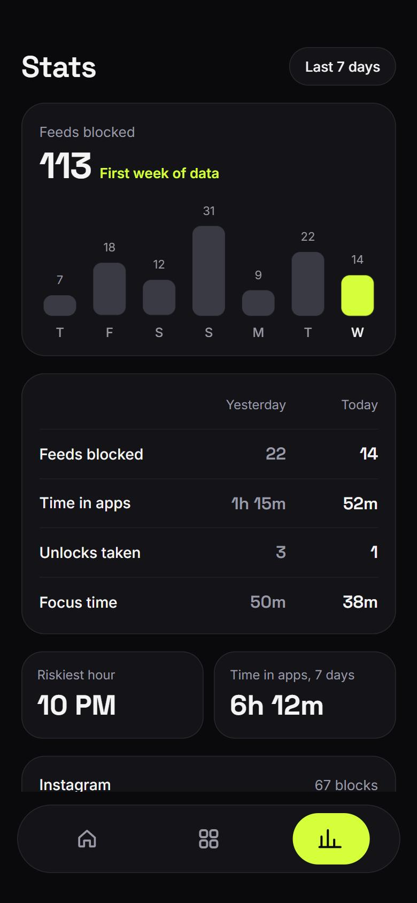

# Breakout

Keep the apps. Lose the scroll.

Breakout is an Expo / React Native app that opens Instagram, YouTube, Facebook, TikTok and more inside its own
full-screen view and **blocks their short-video feeds** (Reels, Shorts, For You, Spotlight...). The rest of each app
keeps working, so you can still message friends and watch normal videos.

Turning blocking off is deliberately costly. Starting a block is instant, but ending one makes you wait, and the wait
grows every time you try.

<p align="center">
  
  
  
  
</p>
<p align="center">
  
</p>

## Features

- **Blocks feeds everywhere they hide.** A reel a friend sends you, a shared link, a reel card in a chat, and swiping
  to the next reel are all stopped, and you get a "this is blocked" pop-up.
  Works for Instagram, YouTube, Facebook, TikTok and Snapchat, plus the feeds of X, Reddit, Threads, Pinterest,
  LinkedIn and Twitch.
- **Escalating unblock cost.** Ending a focus session, switching a block off, spending unlock minutes, or editing your
  block hours all go through a wait that grows with every attempt that day (Opal-style):

  | Difficulty | Waits (1st, 2nd, 3rd... attempt of the day) |
  | ---------- | ------------------------------------------- |
  | Easy       | 5s, 10s, 20s, 40s, 60s, 90s, 2m             |
  | Medium     | 5s, 20s, 50s, 2m, 5m                        |
  | Hard       | 10s, 1m, 3m, 5m, 10m, 15m                   |
  | Brutal     | 30s, 2m, 5m, 10m, 20m, 30m                  |

  Pick the difficulty in Settings. Making it easier is itself gated by the wait.
- **Skip the wait with a rewarded ad.** Hook-point only for now, see [Ads](#ads).
- **Focus sessions**, **schedules** (all day, work hours, nights, custom), a daily **unlock budget**, **strict mode**,
  and **stats** (feeds blocked, time in apps, riskiest hour).
- Everything is stored on the device. Nothing is sent to a server.

## Run it

```bash
npm install
npx expo start
```

Scan the QR code with Expo Go on your phone. The in-app browsers only work on a phone: the web build
(`npx expo start --web`) shows the app's own screens but not the blocked sites.

```bash
npx tsc --noEmit   # typecheck
npx eslint src     # lint
```

## How blocking works

Each app is its mobile website inside a `WebView`. [`src/data/sites.ts`](src/data/sites.ts) lists, per app, the
features that can be blocked (URL patterns plus CSS to hide buttons). A script injected into every page:

- checks the address the moment it changes (including single-page-app navigation), so swiping to the next reel is caught;
- intercepts taps on links to blocked pages before they open;
- pauses video on blocked pages.

The URL rules are the dependable part. The CSS selectors are best-effort because these sites change their markup often.
If something slips through, add its URL pattern to the app's `paths` in `sites.ts`.

## Project layout

```
src/app/          Expo Router screens (tabs, focus, settings, schedule, browse/[id])
src/components/   UI pieces, including UnblockGate (the wait screen)
src/data/         sites (blocking rules), schedule, stats, quiz
src/lib/          store (persistent state), friction (wait ladders), ads (ad hook)
docs/screenshots/ README images
```

## Ads

[`src/lib/ads.ts`](src/lib/ads.ts) is a placeholder that waits 4 seconds. To go live, call `setAdHandler()` once at
startup with a function that shows a rewarded ad (for example with `react-native-google-mobile-ads`) and resolves `true`
only if the user watched it.

## Secrets and environment

Copy `.env.example` to `.env` for local values. `.env` is git-ignored, so never commit it.

> Expo bundles every `EXPO_PUBLIC_*` variable into the app, so anyone can read them. Only put public values there
> (such as ad unit IDs). Real secrets (server API keys, tokens, signing keys) belong on a server or in EAS Secrets.

## Deploying

Builds go through EAS:

```bash
npx eas-cli@latest build --platform ios      # or android
npx eas-cli@latest submit
```

## License

MIT, see [LICENSE](LICENSE).
